<div align="center">

# BetterEnd

**The End overhaul for Minecraft (Fabric): new biomes, islands, mobs, structures, rituals and music for the End.**

[](https://modrinth.com/mod/betterend)
[](https://www.curseforge.com/minecraft/mc-mods/betterend)
[](https://modrinth.com/mod/betterend/versions)

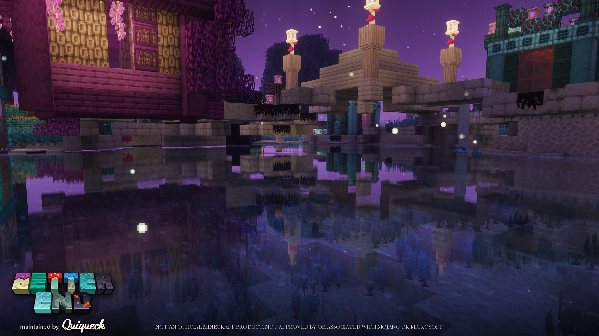

</div>

**BetterEnd** is a Minecraft mod for [Fabric](https://fabricmc.net/) that turns the End from a field of grey islands
into a dimension of its own. Its custom terrain generator shapes islands of different sizes, heights and forms, with
caves inside them, and spreads more than 25 new biomes across them. Each biome has its own plants, resources, mobs,
ambient sounds and music, and the sky gets purple nebulas and stars.

This is the official, actively maintained BetterEnd repository, developed by [Quiqueck](https://github.com/quiqueck)
and Team BetterX. Releases are published on [Modrinth](https://modrinth.com/mod/betterend) and
[CurseForge](https://www.curseforge.com/minecraft/mc-mods/betterend) for **Minecraft 26.3, 26.2, 26.1,
1.21.6–1.21.8 and 1.20.1**.

## Features

- **New End biomes** – Umbrella Jungle, Lantern Woods, Megalake, Crystal Mountains, Painted Mountains, Amber Land,
  Shadow Forest, Sulphur Springs, Foggy Mushroomland, Ice Starfield, Glowing Grasslands, and cave biomes inside the
  islands.
- **Custom End generator** – configurable island shapes, terrain and heights, plus an optional reworked central island.
- **Structures** – End villages, Eternal Portals, giant Mossy Glowshrooms, ice stars, painted mountains, megalakes and
  bridges between islands.
- **Mobs** – Dragonflies, End Fish, End Slimes, Shadow Walkers, Cubozoa and Silk Moths ([see below](#mobs)).
- **Materials and progression** – Thallasium, Terminite and Aeternium tools and armor, Crystalite armor and elytra,
  Infusion Rituals, anvil and smelter recipes.
- **Building blocks** – ten wood types, new stone types and plenty of decoration.
- **Atmosphere** – custom music for the biomes (by Firel), ambient sounds, particles and a new End sky.
- **Mod integrations** – JEI recipes, Mod Menu config screen, and compatibility with popular world generation mods
  ([see below](#compatibility)).

## Screenshots

| | |
|:-:|:-:|
| 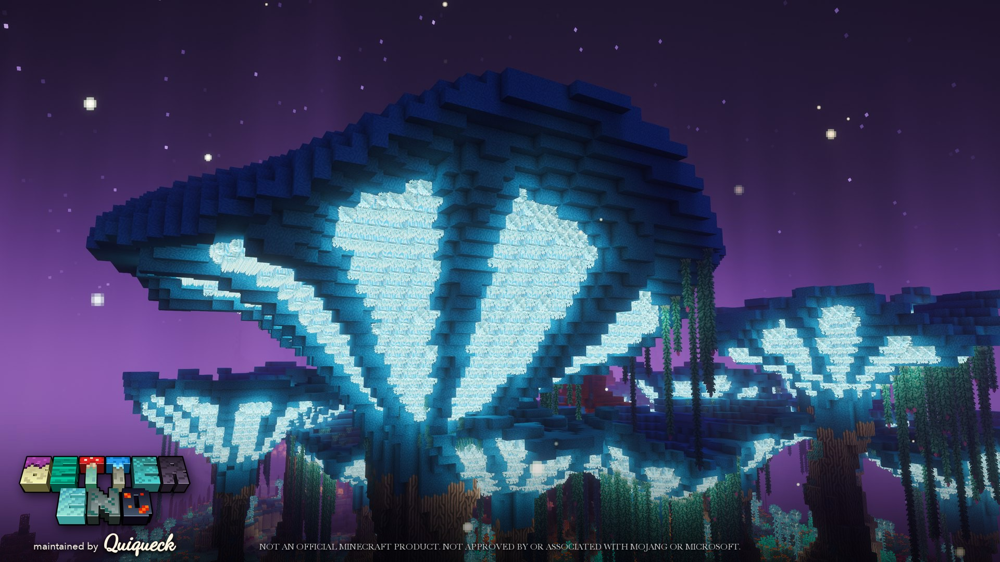 | 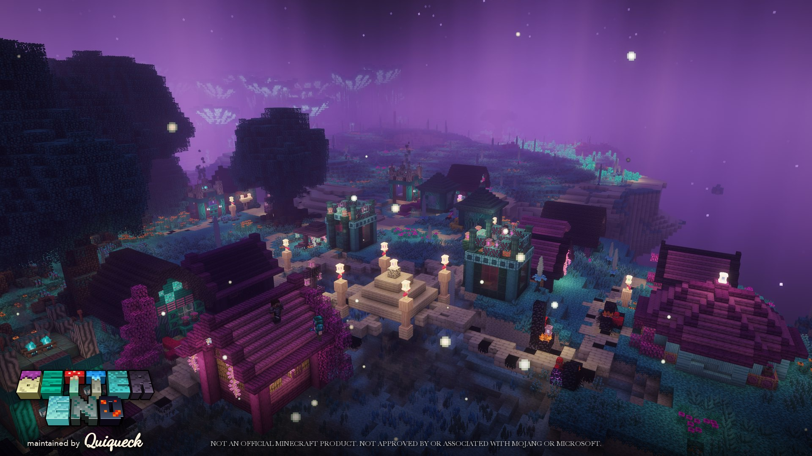 |
| *Giant Mossy Glowshroom* | *End village* |
| 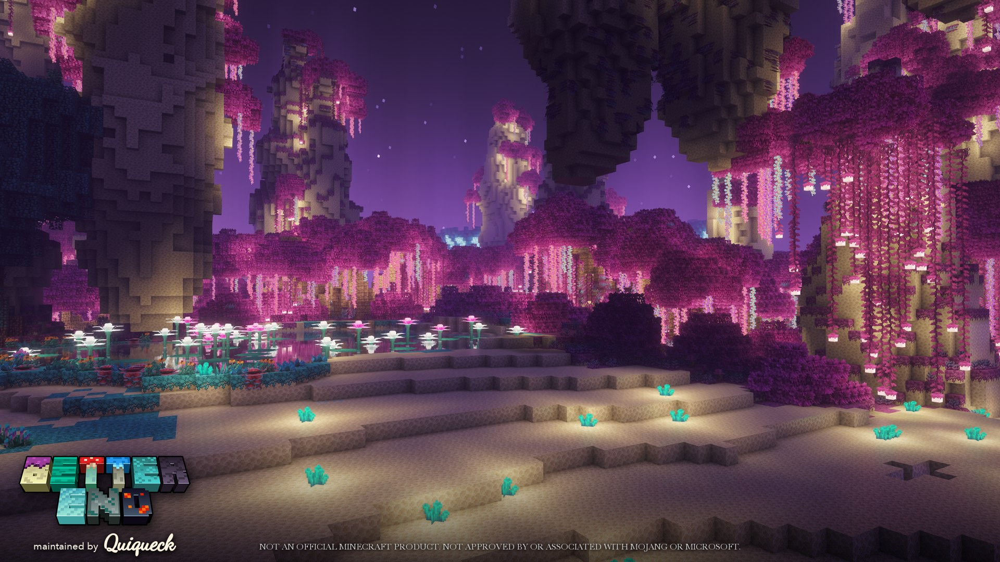 | 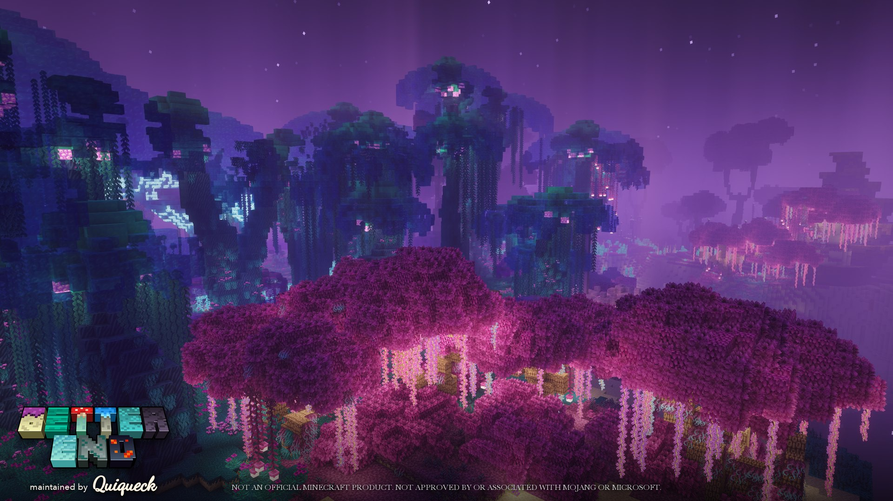 |
| *Lantern Woods* | *Lantern Woods and Umbrella Jungle* |

## Mobs

The creatures that live in BetterEnd's biomes:

| | | |
|:-:|:-:|:-:|
| 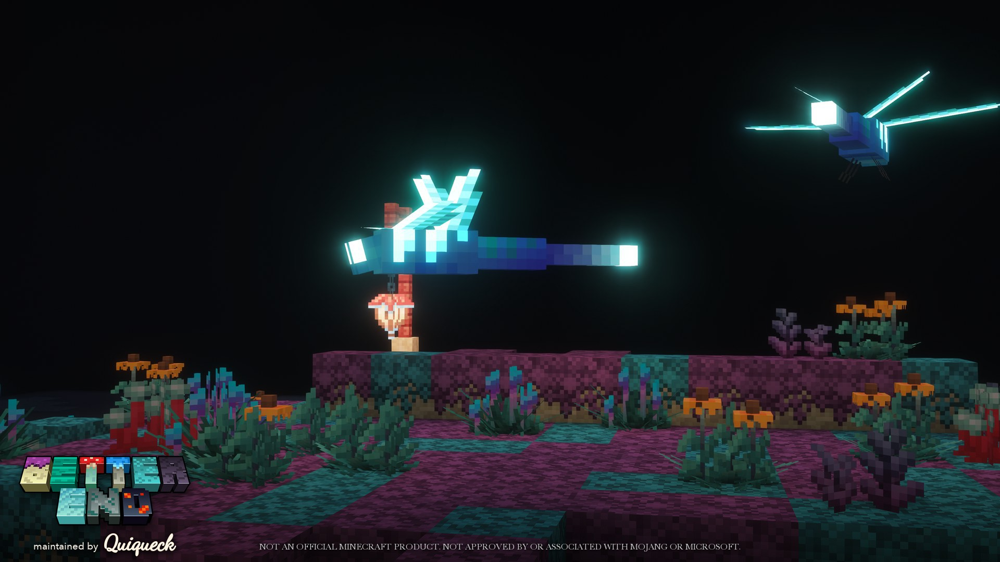 | 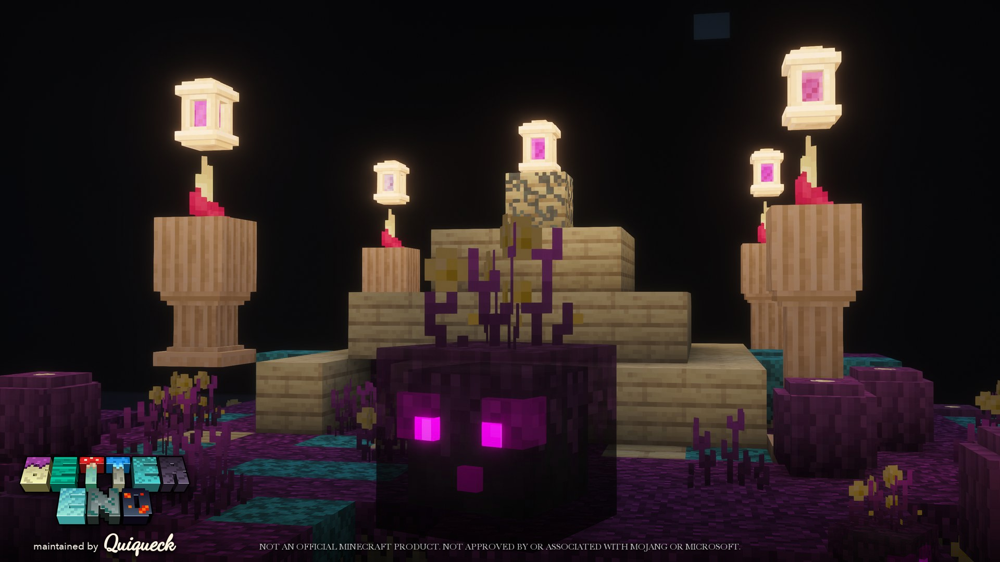 | 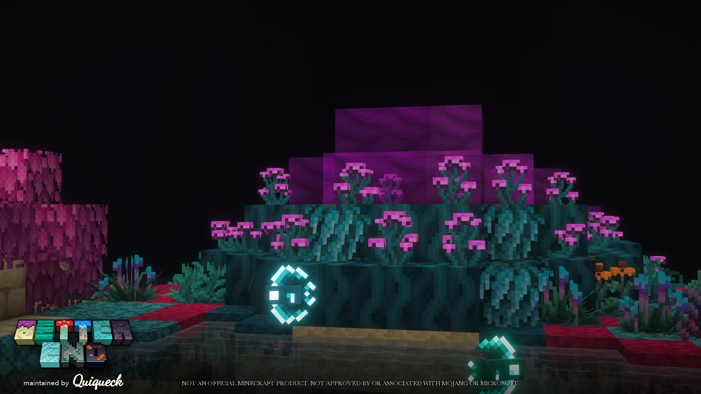 |
| *Dragonfly* | *End Slime* | *End Fish* |
| 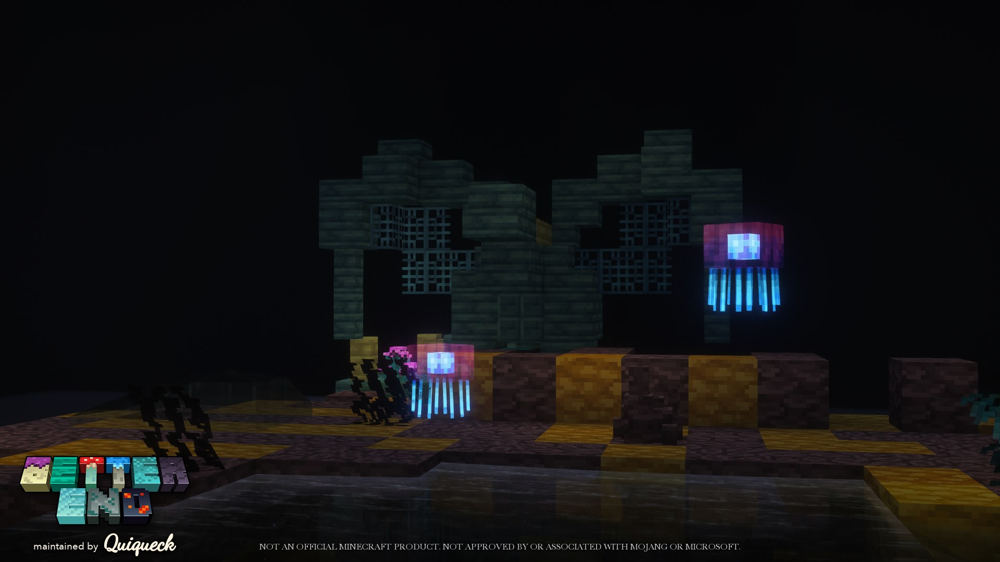 | 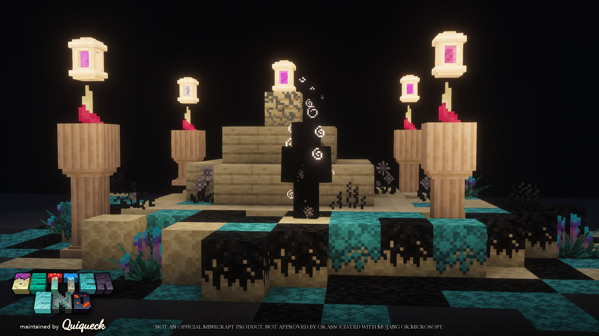 | 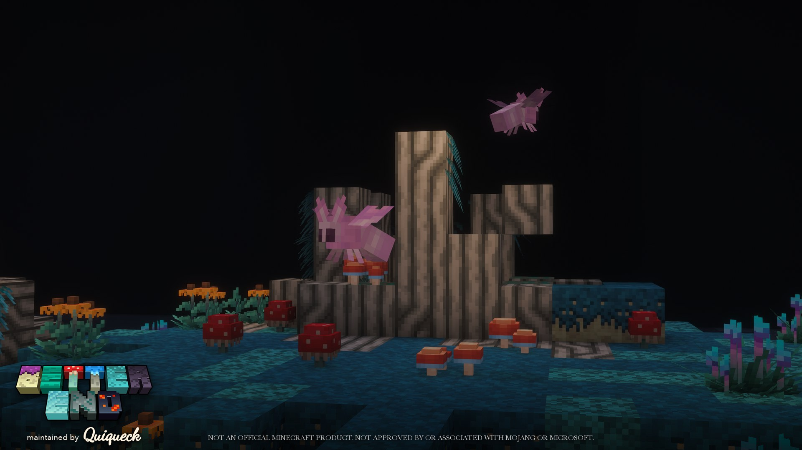 |
| *Cubozoa* | *Shadow Walker* | *Silk Moth* |

## Download

The latest Fabric release for each supported Minecraft version (the badges update automatically):

| Minecraft | Modrinth | CurseForge |
|:--|:--|:--|
| **26.3** | [](https://modrinth.com/mod/betterend/versions?g=26.3&l=fabric) | [](https://www.curseforge.com/minecraft/mc-mods/betterend/files/all?version=26.3&gameVersionTypeId=4) |
| **26.2** | [](https://modrinth.com/mod/betterend/versions?g=26.2&l=fabric) | [](https://www.curseforge.com/minecraft/mc-mods/betterend/files/all?version=26.2&gameVersionTypeId=4) |
| **26.1 – 26.1.2** | [](https://modrinth.com/mod/betterend/versions?g=26.1.2&l=fabric) | [](https://www.curseforge.com/minecraft/mc-mods/betterend/files/all?version=26.1.2&gameVersionTypeId=4) |
| **1.21.6 – 1.21.8** | [](https://modrinth.com/mod/betterend/versions?g=1.21.8&l=fabric) | [](https://www.curseforge.com/minecraft/mc-mods/betterend/files/all?version=1.21.8&gameVersionTypeId=4) |
| **1.20 – 1.20.1** | [](https://modrinth.com/mod/betterend/versions?g=1.20.1&l=fabric) | [](https://www.curseforge.com/minecraft/mc-mods/betterend/files/all?version=1.20.1&gameVersionTypeId=4) |

**Required:** [Fabric API](https://modrinth.com/mod/fabric-api), [BCLib](https://modrinth.com/mod/bclib) and
[WorldWeaver](https://modrinth.com/mod/worldweaver) (1.21.6 and newer).
**Optional:** [JEI](https://modrinth.com/mod/jei), [Mod Menu](https://modrinth.com/mod/modmenu).

## Compatibility

Every release is validated against popular world generation and tech mods. A dedicated server boots BetterEnd with
each of these mods (alone and all together), runs BetterEnd's full GameTest suite, and checks that every mod's biomes
still generate in their dimensions, that WorldWeaver's world generator stays in charge, and that BetterEnd's surface
rules survive. The results are listed under *Validation* in each release's changelog.

<!-- mod-task:verified:start -->

| Mod | Verified version (Minecraft 26.3) | Get it |
|:--|:--|:--|
| [](https://modrinth.com/mod/biomes-o-plenty) | `26.3.0.0.13` | [](https://modrinth.com/mod/biomes-o-plenty) [](https://www.curseforge.com/minecraft/mc-mods/biomes-o-plenty) |
| [](https://modrinth.com/mod/terralith) | `2.6.5` | [](https://modrinth.com/mod/terralith) [](https://www.curseforge.com/minecraft/mc-mods/terralith) |
| [](https://modrinth.com/mod/incendium) | `5.5.3` | [](https://modrinth.com/mod/incendium) [](https://www.curseforge.com/minecraft/mc-mods/incendium) |
| [](https://modrinth.com/mod/nullscape) | `2.0.1` | [](https://modrinth.com/mod/nullscape) [](https://www.curseforge.com/minecraft/mc-mods/nullscape) |
| [](https://modrinth.com/mod/stellarity) | `6.0.1` | [](https://modrinth.com/mod/stellarity) [](https://www.curseforge.com/minecraft/mc-mods/stellarity) |
| [](https://modrinth.com/mod/techreborn) | `6.2.0` | [](https://modrinth.com/mod/techreborn) [](https://www.curseforge.com/minecraft/mc-mods/techreborn) |

<!-- mod-task:verified:end -->

## You might also like

- [**BetterNether**](https://github.com/quiqueck/BetterNether) – new biomes, mobs and structures for the Nether.
- [**Wunderreich**](https://github.com/quiqueck/wunderreich) – vanilla+ mechanics for storage, trading and building.

## Links

- [Wiki](https://modwiki.ambertation.de/#/en/26_1_x/mod/betterend)
- [Issue tracker](https://github.com/quiqueck/BetterEnd/issues)

## Building from source

You need JDK 25 for the 26.x branches (JDK 21 for 1.21.x, JDK 17 for 1.20.1).

```bash
git clone https://github.com/quiqueck/BetterEnd.git
cd BetterEnd
./gradlew build
```

The mod jar is written to `build/libs`.

Each Minecraft version has its own release branch: `release/26.3`, `release/26.2`, `release/26.1`, `release/1.21.6` and `release/1.20` (1.20.1).

## Credits and license

BetterEnd was created by paulevs and Bulldog83, and is maintained by
[Quiqueck](https://github.com/quiqueck) and Team BetterX. Art by paulevs, Bulldog83, Yuki, Seaward and GustlGo, buildings by
Edos, GustlGo and Elixy, music by Firel. The original repository is archived; all development happens here.

The source code is licensed under the [MIT License](LICENSE).

**Assets (2026-10-30).** Assets (textures, images, models, music and sounds) are not covered by the MIT License.
They are governed by [LICENSE.ASSETS](LICENSE.ASSETS), which also lists their authors: unless stated otherwise, they
are All Rights Reserved, and a listed subset is licensed under CC BY-NC-SA 4.0 (attribution: Team BetterX).
As long as they stay unmodified and bundled with the official mod release, you may use them in modpacks and on
servers (commercial and non-commercial ones). You may also show them in videos, streams and screenshots.

## AI Usage

The ideas and the design of BetterEnd are human-made: we come up with the concepts, guide every design decision and implement the code. We use agentic AI as a tool for the following tasks:

- tooling and automation,
- code review,
- proofreading and writing documentation (code comments and this README),
- boilerplate work, including migrating the codebase to new Minecraft versions,
- many of our automated tests.

Everything the AI generates is reviewed and, where needed, edited by us before it is released. We also playtest every release ourselves.
